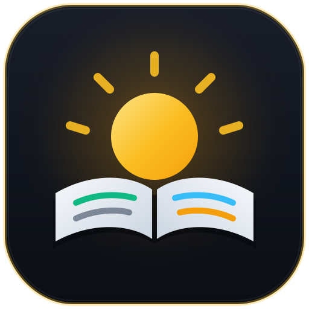

# Daybook



[English](README.md) | 中文

**不只是日志 — 面向多编码智能体的上下文归档与工程台账系统。**

Daybook 自动发现、总结并从你的 **Claude Code**、**Codex** 和 **Pi** 编程会话中提炼可复用的工程知识。它既可以作为本地归档工具运行，也可以作为带有 **Quiet Precision / Dark Obsidian** 仪表盘的中心化 SQLite 台账服务器运行。

## 功能特性

- **多智能体会话发现** - 自动扫描 Claude Code（`~/.claude/projects/`）、Codex（`~/.codex/sessions/`）与 Pi（`~/.pi/agent/sessions/`）会话记录，并自动将 git worktree 归属回主仓库。
- **跨智能体智能总结** - 基于证据总结具体产出、关键决策、踩坑记录与可复用候选规则，不绑定单一智能体假设。
- **三层知识分类（`v2`）** - 严格区分跨仓库通用的 **全局技能（`global-skill`）**、仓库专属的 **项目规则（`repo-rule` -> `<repo>/AGENTS.md`）** 以及一次性 **会话踩坑与认知（`[PITFALL]` / `[LEARNING]`）**。
- **中心化 SQLite 台账与多机同步** - 支持通过 `daybook scan` 将多台机器的会话推送到中心服务（`daybook serve` / `daybook show`），支持 Bearer Token 鉴权（`daybook token`）与离线队列（`~/.daybook/pending/`）自动重试。
- **5 分钟每日简报仪表盘** - 采用 **Quiet Precision / Dark Obsidian** 设计系统，按项目展示交付成果、成本与缓存命中率、工作流诊断建议、可一键复制的 `SKILL.md` 与 `AGENTS.md` 规则以及会话详情。

## 安装

### 一键安装

```bash
curl -fsSL https://raw.githubusercontent.com/Vikaspogu/daybook/main/scripts/install.sh | bash
```

### 从源码构建

```bash
git clone https://github.com/Vikaspogu/daybook.git
cd daybook
cd web && npm install && npm run build && cd ..
cargo install --path .
```

## 快速开始

```bash
# 1. 初始化 Daybook（默认目录 ~/.daybook）
daybook init

# 2. 扫描并总结今日 Claude Code / Codex / Pi 会话
daybook scan --day today

# 3. 打开 Web 仪表盘（默认：http://127.0.0.1:31456）
daybook show

# 4. 在终端查询每日简报或 7 天统计（连接运行中的 `daybook show` / `daybook serve` 或 `push.url`）
daybook query
daybook stats --week
```

## 三层知识分类（`v2` 规范）

Daybook 在总结会话时会将每条经验归入唯一的目标位置，避免将项目细节或单机环境问题混入全局技能：

1. **全局可复用技能（`Scope: global-skill`）**
   - **目标位置**：`~/.agents/skills/<name>/SKILL.md`（仪表盘复制草稿）或 `~/.claude/skills/<name>/SKILL.md`（通过 `daybook review-skills --install` 安装）
   - **标准**：跨仓库通用的多步调查、验证或工程操作流程，不依赖单一仓库的私有目录或服务名。
   - **仪表盘操作**：在 **Global Reusable Skills** 卡片中一键复制完整的 `SKILL.md`（含 YAML frontmatter、`When to use`、`Procedure` 与 `Verification`）。
2. **仓库指令规则（`Scope: repo-rule`）**
   - **目标位置**：`<repo>/AGENTS.md`（或 `CLAUDE.md`）
   - **标准**：与特定仓库架构、目录结构、配置依赖或验证步骤绑定的持久规则。
   - **仪表盘操作**：按仓库分组展示在 **Repository Rules (`<repo>/AGENTS.md`)** 中，支持单条或按仓库一键复制。
3. **会话踩坑与收获（`[PITFALL]` / `[LEARNING]`）**
   - **目标位置**：会话 `## Learnings` 及仪表盘 **Pitfalls & Gotchas / Codebase Learnings — By Project**。
   - **标准**：单机缺失系统包、临时权限刷新、环境偶发问题或项目具体认知。

## 常用命令

| 命令 | 描述 |
| --- | --- |
| `daybook init` | 初始化配置并创建存储目录（`~/.daybook`） |
| `daybook scan [--day today\|yesterday\|all\|YYYY-MM-DD]` | 扫描 Claude Code、Codex、Pi 会话并总结/同步 |
| `daybook show [--port 31456] [--no-open]` | 启动 Web 仪表盘与台账 API 服务 |
| `daybook serve [--host 0.0.0.0] [--port 31457]` | 启动无头 SQLite 台账接收与查询服务 |
| `daybook query [YYYY-MM-DD]` | 在终端输出指定日期的交付概览与会话总结 |
| `daybook stats [--week \| --month \| --days N]` | 查看会话数、Token、成本、缓存命中率与摩擦率统计 |
| `daybook token [--list \| --label <name> \| --revoke <label>]` | 签发、列出或吊销机器同步 Token（`dbk_...`） |
| `daybook view [--date YYYY-MM-DD] [--list]` | 在终端查看本地归档 |
| `daybook today` / `daybook yest` | 查看今日或昨日归档的快捷命令 |
| `daybook digest [yest] [--date YYYY-MM-DD] [--force]` | 将单日会话归档合并至 `daily.md` |
| `daybook insights [--days 30]` | 查看终端工作洞察与趋势统计 |
| `daybook extract-skill` / `daybook extract-command` | 从归档会话中手动提取技能或命令 |
| `daybook review-skills [--install <id> \| --delete <id>]` | 列出、安装（至 `~/.claude/skills/<name>/SKILL.md`）或删除本地待审核技能 |
| `daybook config [--show \| -i]` | 查看或交互式修改配置 |
| `daybook jobs <list\|log\|kill\|cleanup>` | 管理后台总结任务 |

## 中心化服务器与多机同步

可将 `daybook show` 或 `daybook serve` 部署在中心主机或容器中（`ghcr.io/vikaspogu/daybook:latest`），并将多台开发机的会话推送到同一 SQLite 台账：

```toml
# 服务端 (~/.config/daybook/config.toml，可通过 daybook config --show 查看路径)
[server]
port = 31457
db_path = "/data/daybook.db"
admin_token = "replace-with-admin-token"

# 客户端开发机
[push]
url = "https://daybook.example.com"
token = "dbk_..."
machine = "workstation-01"
```

使用 `daybook token --label workstation-01` 签发机器 Token。若服务端暂时不可达，记录会暂存在 `~/.daybook/pending/` 并在下次运行时自动重放。

## 系统要求

- Rust 工具链（`cargo`，Edition 2021，从源码构建时需要）
- Node.js 与 npm（构建 `web/` 或 `site/` 时需要）
- Claude CLI（`claude`，用于会话 AI 总结）

## 许可证

MIT License - 详见 [LICENSE](LICENSE)。
